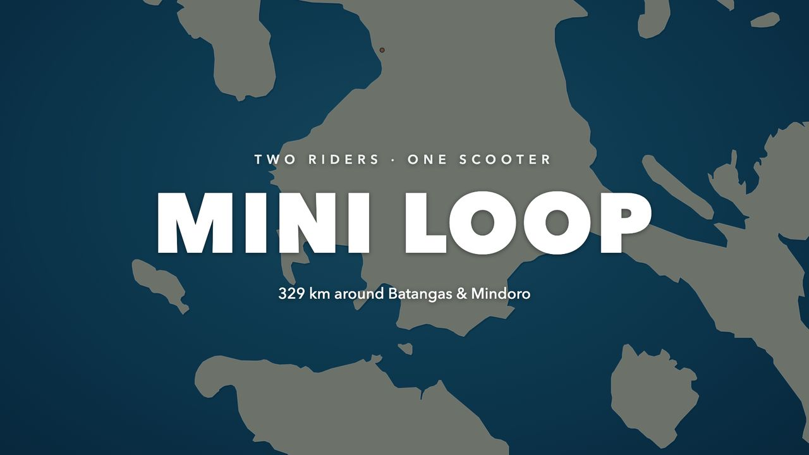
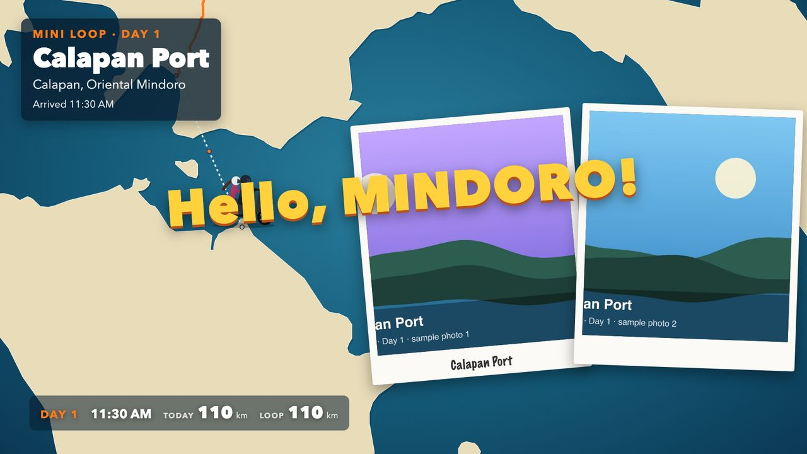
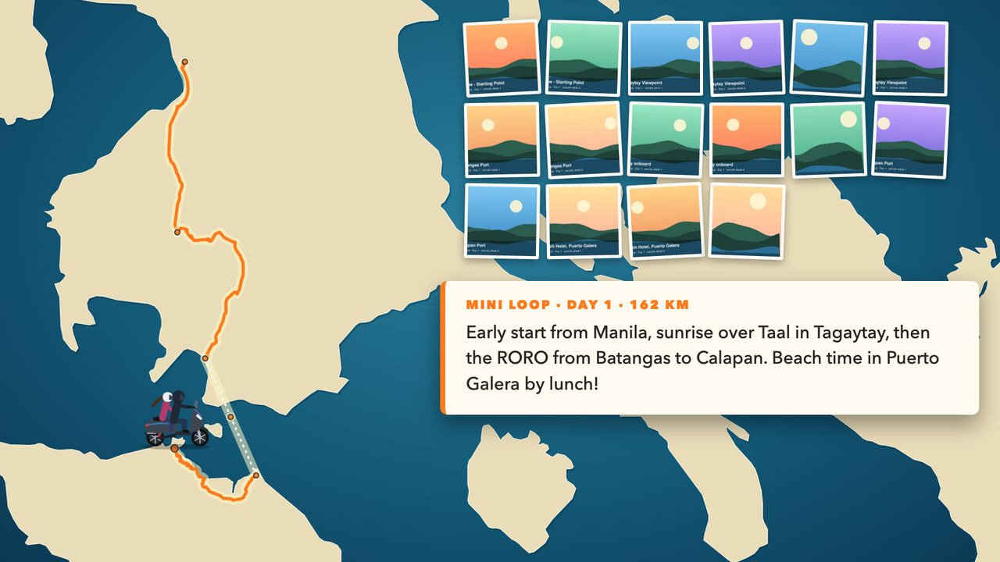
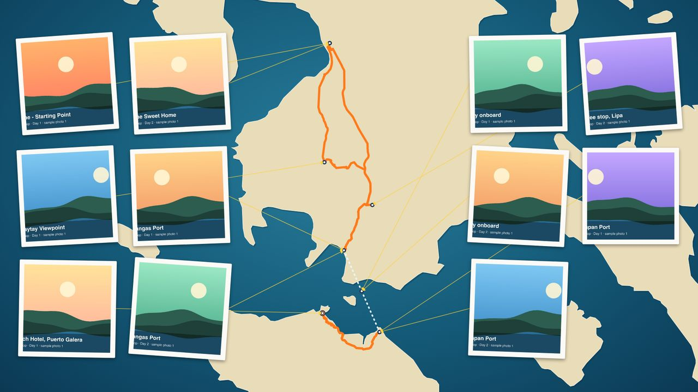

# PH Loop Video Creator

Turn the photos and notes from a motorcycle road trip into an animated map video. A little bike carrying you (and your passenger) rides the real roads from stop to stop, boards ferries for sea crossings, and shows your photos, arrival times, distances and stories along the way.

Made after riding the **Philippine Loop** (South + North), but it works for any trip, anywhere.

<p>
  
  
  
  
</p>

<sub>Screenshots are from the included demo trip, with generated placeholder photos.</sub>

## What the video shows

- **Intro**: your trip facts drop in one by one ("1 scooter · 2 people · 15 riding days · 6 ferry rides …"), then the title.
- **The ride**: a side-view scooter or motorcycle with 1 or 2 riders moves along the actual road route. On a ferry crossing it switches to a boat.
- **Each stop**: the stop name, the town, the arrival time and km from the last stop, a short note, and a collage of your photos and video clips.
- **Running numbers**: a clock that ticks during each ride, plus two odometers: **today** and **whole loop**. Ferry crossings don't add km.
- **End of each day**: the map zooms out to the day's route, which glows, then shows every photo from that day next to the day's story.
- **Finale**: zoom out to the whole trip with a photo from every stop and an arrow to its pin, then the totals. Last comes an optional "proof of completion" section (medal, plaque, shirt…).
- **Music**: one song per part of the trip, crossfading between them.

## Requirements

- **[Node.js](https://nodejs.org) 18 or newer** (20 LTS recommended). That's all; ffmpeg ships with the renderer.
- About 2 GB of free disk space for dependencies and the render.
- An internet connection the first time you build a trip, to look up routes and town names (results are cached).

Tested on macOS. It should also work on Windows and Linux; please open an issue if it doesn't.

## Quick start: try the demo

```bash
git clone https://github.com/fringify/ph-loop-video-creator.git
cd ph-loop-video-creator
npm install
npm run demo      # makes placeholder photos for a 2-day sample trip and prepares it
npm run studio    # opens a live preview in your browser
```

To render it to an MP4 file instead, run `npm run render`; the result is in `out/trip-video.mp4`.

## Make your own

### 1. Answer a few questions

```bash
npm run setup
```

You'll be asked:

| Question | Example |
|---|---|
| Trip folder | `my-trip` (kept private; it's in `.gitignore`) |
| Video title | `PH LOOP` |
| What did you ride? | Scooter (NMAX, ADV, PCX, Aerox…) or Motorcycle |
| Vehicle colour | grey |
| How many people on the bike? | 1 or 2 |
| For each rider: look, jacket and helmet colour | Male, black, black / Female (ponytail), pink, white |
| Line above the title | `TWO RIDERS · ONE SCOOTER` |
| Where? | `the Philippines` → "4,886 km around the Philippines" |
| How many parts was the trip split into? | 2 (e.g. South Loop and North Loop) |
| For each part: name, dates, song | `South Loop`, `Dec 1 – 11, 2025`, `Legends` |
| Target video length | 10 minutes |
| Closing message | `Until the next ride!` |
| Time zone | `+08:00` |

This creates `my-trip/trip.config.json` and the folders below. You can run setup again at any time: your answers become the defaults, and it never deletes your files.

### 2. Add your photos

```
my-trip/
├── trip.config.json        ← from npm run setup
├── photos/
│   ├── South Loop/         ← one folder per part (same name as in setup)
│   │   ├── Day 1/
│   │   │   ├── 1.0.jpg     ← stop 1
│   │   │   ├── 1.1.HEIC
│   │   │   ├── 2.0.jpg     ← stop 2
│   │   │   ├── 2.1.MOV     ← videos become short clips
│   │   │   └── 3.0 S - ferry to Calapan.mov   ← text after the number is a caption
│   │   ├── Day 2/
│   │   └── Day 10 - 11/    ← a 2-day stretch is fine
│   └── North Loop/
├── notes/
│   └── South Loop/
│       ├── Day 1.txt
│       └── Day 2.txt
├── story.json              ← optional: day stories, notes, banners
├── overrides.json          ← optional: fix a pin or a name
├── music/                  ← optional: your songs (.mp3/.m4a)
└── finish/                 ← optional: medal, plaque, shirt photos
```

**The first number in a photo's file name is the stop.** Two styles work, one per day folder:

| Style | Files | Stop |
|---|---|---|
| Dotted | `2.0.jpg`, `2.1.jpg`, `2.10.jpg` | 2 |
| Two-digit | `20.jpg`, `21.jpg` … `100.jpg` | 2 … 10 (first digits ÷ 10) |

JPG, PNG, HEIC, MOV and MP4 are all fine. Photos straight from a phone usually carry GPS, which places stops automatically. Without GPS, give the stop a pin in the notes.

### 3. Write the day notes

One text file per day, using the same number for each stop as the photos:

```text
1. Home - Starting Point
  - pin: 14.5995, 120.9842
  - Start ride: 5:00 AM

2. Batangas Port
  - 135km from previous
  - Arrived at 3:48 AM
  - https://maps.app.goo.gl/xxxxxxxx

3. Ferry onboard

4. Calapan Port
  - Arrived at 7:13 AM
  - https://maps.app.goo.gl/yyyyyyyy

Notes:
Anything after "Notes:" is your full story of the day (kept for reference).
```

- **Pin**: a Google Maps share link, or `pin: lat, lon`. If a pin is more than 20 km from where that stop's photos were taken, the photo GPS wins (it catches copy-pasted links).
- **km** is shown and added to the odometers. Leave it out and the routed road distance is used.
- **Arrived / Start ride** times drive the clock. Without them, the time a photo was taken is used.
- A stop named like **"Ferry onboard"** or **"In the ferry going to …"** with no pin is treated as on the boat: the crossing is drawn over water and adds 0 km.
- Text after the first `. ` in a name becomes a small note: `9. Motorshop. Ran out of oil, pushed for 30 minutes`.

The full reference is in **[docs/FORMAT.md](docs/FORMAT.md)**.

### 4. Optional extras

`my-trip/story.json`:

```json
{
  "days":       { "South Loop / Day 1": "Shown at the end of the day next to all its photos." },
  "moments":    { "South Loop / Day 1 / 2": "First time on a RORO!" },
  "banners":    { "South Loop / Day 3 / 5": "Touchdown MINDANAO!!!!" },
  "emoji_legs": { "South Loop / Day 3 / 2": ["🏍️", "💨", "☀️"] },
  "time_fixes": { "South Loop / Day 2 / 7": "6:30 PM" }
}
```

`my-trip/overrides.json` fixes single stops: `title`, `pos: [lat, lon]`, `pos_from_file: "70.jpg"`, `leg: "sea"` (force a ferry crossing into this stop) or `skip: true`.

**Music**: drop songs into `music/` and type a word from the file name for each part during setup (or set `loops[].music` in the config). Only use music you have the rights to. Facebook and YouTube may mute or block commercial songs.

**Finish photos**: put them in `finish/` and list them in `trip.config.json`:

```json
"finish": {
  "subtitle": "PROOF OF COMPLETION",
  "title": "Philippine Loop Conqueror",
  "items": [{ "file": "plaque.jpg", "caption": "Achievement Award" }]
}
```

### 5. Build, preview, render

```bash
npm run build     # reads my-trip/, looks up routes, converts photos (re-run after any change)
npm run studio    # live preview in the browser: scrub, pause, check things
npm run sample    # ~1 minute MP4 (the intro + one day) → out/sample.mp4
npm run render    # the full video → out/trip-video.mp4
```

The first build of a big trip takes a few minutes, because the free map services allow about one lookup per second. After that, everything is cached in `my-trip/.cache/` and rebuilds take seconds. A 10-minute video renders in roughly 20–30 minutes on a recent laptop.

Using a different folder? Add `-- --trip path/to/trip` to `build`. The other commands use whatever you built last.

## Commands

| Command | What it does |
|---|---|
| `npm run setup` | Asks questions, writes `trip.config.json`, creates folders and templates |
| `npm run build` | Scans photos and notes, routes, converts media, writes `src/data/` |
| `npm run studio` | Opens the Remotion preview in your browser |
| `npm run sample` | Renders about 1 minute: the intro and the sample day (set in config) |
| `npm run render` | Renders the full video |
| `npm run demo` | Generates and builds the sample trip in `examples/demo-trip` |

## Tuning

- **Video too long?** Lower `targetMinutes`. Stops then show fewer photos (the end-of-day mosaics still show them all).
- **Wrong pin?** Add an override, or fix the link or `pin:` in the notes, then `npm run build`.
- **A ferry drawn over land**, or a land route that should be a ferry: set `"leg": "sea"` for the stop you arrive at.
- **Colours**: each part's route colour is `loops[].color`. The vehicle and rider colours are in `vehicle` and `riders`.
- **Timing and layout** live in `src/timing.ts` and `src/*.tsx` (React + [Remotion](https://www.remotion.dev)). If you change timings, keep `scripts/lib/prepare.ts` in sync.

## Privacy

Your trip folder (`my-trip/`), the converted media (`public/`), the generated data (`src/data/`) and renders (`out/`) are all git-ignored, so pushing this repo never uploads your photos. Building sends stop coordinates to the public OSRM and Nominatim servers to get routes and town names. You can point `services` in the config at your own instances.

## Credits and licenses

- Code: [MIT](LICENSE).
- Video rendering: [Remotion](https://www.remotion.dev). Free for individuals and small companies; [check their license](https://www.remotion.dev/license) for company use.
- Map shapes: [Natural Earth](https://www.naturalearthdata.com) via [world-atlas](https://github.com/topojson/world-atlas) (public domain).
- Routes: [OSRM](https://project-osrm.org). Town names: [Nominatim](https://nominatim.org). Both use data © [OpenStreetMap contributors](https://www.openstreetmap.org/copyright). Please respect their [usage policy](https://operations.osmfoundation.org/policies/nominatim/) and keep builds occasional.
- Photos and music in your videos are yours to license.
